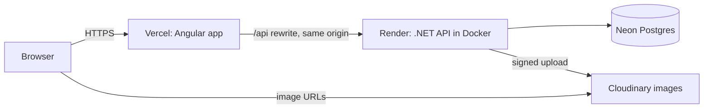

# Kinbo: handmade Bangladeshi goods

A real single-shop e-commerce site for one-of-a-kind nakshi kantha and everyday jute goods, built as a
portfolio piece: **.NET 10 Web API + Angular 22 + PostgreSQL**, multi-tenant-ready, with the concurrency,
auth and payment details done properly. The full spec is in [PROJECT_PROMPT.md](PROJECT_PROMPT.md).

**Live demo:** _add the Vercel URL after deploying_ · use **Try the demo** on the sign-in page.

## What it does

- **One-of-a-kind pieces are held for 15 minutes** when added to a cart. Two shoppers grabbing the same piece:
  exactly one wins (a single conditional upsert), the other sees "held by another shopper".
- **Cash-on-delivery checkout** that re-checks prices, holds and stock on the server, with optimistic
  concurrency on stock so an item can never be oversold.
- **Accounts** with short-lived JWTs in memory and rotating refresh tokens in httpOnly cookies; the cart you
  built before signing in comes with you.
- **Admin**: dashboard, orders with a status workflow (cancelling restores stock), products with photo upload,
  artisans.
- Calm, accessible UI: mobile-first, WCAG AA contrast, keyboard friendly, light and dark themes, and a
  running-stitch motif drawn from kantha embroidery.

## Architecture



- `api/`: `Shop.Api` (controllers, auth, middleware) → `Shop.Application` (feature services: Auth, Catalog,
  Carts, Orders, Admin) → `Shop.Infrastructure` (DbContext, migrations, seed, image storage) → `Shop.Domain`.
  Services use the DbContext directly: no repositories, no MediatR.
- `web/`: standalone Angular components, signals and `httpResource`, lazy feature routes, design tokens in
  `src/styles/_tokens.scss`.
- Vercel proxies `/api` to Render, so the browser only ever talks to one origin: the refresh cookie is
  first-party and no CORS is needed.

## Local setup

Requirements: .NET 10 SDK, Node (version in `.nvmrc`), Docker.

```bash
cp .env.example .env                 # then set POSTGRES_PASSWORD (and POSTGRES_PORT if 5432 is taken)
dotnet user-secrets --project api/Shop.Api set ConnectionStrings:Default "Host=localhost;Port=<POSTGRES_PORT>;Database=shop;Username=shop;Password=<same password>"
dotnet user-secrets --project api/Shop.Api set Auth:SigningKey "$(openssl rand -base64 48)"
dotnet user-secrets --project api/Shop.Api set Seed:AdminPassword "<choose one>"
npm --prefix web ci
./scripts/dev.sh                     # Postgres + API (:5277) + web (:4200), stopped together with Ctrl+C
```

The API migrates and seeds itself on startup (1 store, 4 categories, 3 artisans, 16 products, an admin and two
demo accounts). If pages say "didn't load" and the network tab shows `502 Bad Gateway`, the API isn't running:
use `./scripts/dev.sh` rather than `npm start` alone.

To run the API from its production Docker image instead (as Render does), add `AUTH_SIGNING_KEY` to `.env` and run
`docker compose --profile full up --build`: the API listens on http://localhost:8080.

Quality gate, same as CI: `./scripts/check.sh` (build with warnings as errors, 135+ integration tests on real
Postgres via Testcontainers, lint, Angular tests, production build).

## Try it

1. Open http://localhost:4200 and add a one-of-a-kind piece: the cart drawer shows a 15-minute countdown.
   Open the same piece in a private window: it shows as held by another shopper.
2. Checkout asks you to sign in: choose **Try the demo as a shopper**. Your cart comes with you.
3. Place a cash-on-delivery order (any Bangladeshi mobile number, e.g. 01712345678). The piece is now sold.
4. Sign in with **Try the demo as an admin** and open **Admin**: confirm and ship the order, edit stock, add a
   product photo. Cancelling an order puts the stock back.

## Configuration

Settings are standard ASP.NET Core configuration: `appsettings.json` holds safe defaults; secrets go in
`dotnet user-secrets` locally and environment variables in production (`__` for nesting, e.g.
`Auth__SigningKey`). Nothing secret is committed; see `appsettings.Development.json.example` and `.env.example`.

| Setting | Required | What it is |
|---|---|---|
| `ConnectionStrings__Default` | yes | Npgsql connection string. Neon: `Host=<host>;Database=<db>;Username=<user>;Password=<password>;SSL Mode=Require` |
| `Auth__SigningKey` | yes | HS256 key for access tokens, at least 32 bytes (`openssl rand -base64 48`) |
| `Seed__AdminPassword` | for an admin login | Password of `admin@kinbo.test`. Without it the admin isn't created; demo accounts still are |
| `Images__CloudinaryCloudName`, `Images__CloudinaryApiKey`, `Images__CloudinaryApiSecret` | for photo uploads in production | Signed Cloudinary uploads. Without them, development stores uploads on local disk and production refuses uploads (`IMAGE_STORAGE_NOT_CONFIGURED`), since Render's disk is wiped on deploy |
| `Shop__Name`, `Shop__ShippingFee`, `Shop__FreeShippingThreshold` | no | Defaults: Kinbo, 120, 3000 |
| `Database__MigrateOnStartup`, `Seed__Enabled` | no | Both default to `true` |
| `RateLimits__LoginPerMinute`, `RateLimits__RegisterPerMinute` | no | Defaults 5 and 3 per IP |

Business contact details shown on the legal pages live in `web/src/app/core/shop-info.ts`.

## Deploy (free tiers)

1. **Neon**: create a project and copy the connection string; convert it to the Npgsql format above.
2. **Render**: New → Blueprint → pick this repo. `render.yaml` builds `api/Dockerfile`, checks
   `/api/health`, and generates `Auth__SigningKey`. Fill in the connection string, admin password and
   Cloudinary values when asked.
3. **Vercel**: import the repo with **Root Directory `web`**. In `web/vercel.json`, change the `/api` rewrite
   destination to your Render URL (e.g. `https://kinbo-api.onrender.com`) before the first deploy.
4. Open the Vercel URL and use **Try the demo**.

A demo walkthrough script for a short video is in [docs/demo-script.md](docs/demo-script.md).

## Design decisions

**Tenancy.** Every tenant-owned table has a `StoreId`, enforced by an EF Core global query filter and stamped on
insert, so feature code can't forget it. There is one store today (resolved from config per request), but adding
subdomain or header-based resolution later changes one middleware, not every query. Tests prove store A never
sees store B's products, carts, orders or admin data.

**Concurrency.** Two different problems, two tools:
- *Unique pieces* (stock 1) are claimed with a single `INSERT … ON CONFLICT (product_id) DO UPDATE … WHERE
  expired OR mine` on the reservations table: one atomic statement decides the winner, tested with 10 shoppers
  racing for one piece. Re-adding a piece you hold doesn't extend the 15 minutes.
- *Standard stock* is decremented at checkout with optimistic concurrency on Postgres `xmin`, retried once,
  then `OUT_OF_STOCK`. Admin edits carry the `xmin` version they loaded, so a stale form can't overwrite stock
  that a checkout just changed. Cancelling an order restores stock the same way.
- Checkout locks the shopper's cart row, so a double submit places one order.

**Auth.** Access tokens are 15-minute JWTs kept in memory only, never in localStorage, so XSS can't lift a
long-lived token. Refresh tokens are random 64-byte values in an httpOnly, Secure, SameSite=Lax cookie scoped
to `/api/auth`, stored only as SHA-256 hashes, rotated on every use; presenting a rotated token revokes the
whole family. Two tabs refreshing at once is treated as a race (30-second grace), not theft. The Angular
interceptor shares one refresh between concurrent 401s. Login and sign-up are rate-limited per IP.

**Payments.** Cash on delivery today; the shop confirms each order by phone. Card payments (Stripe test mode,
Checkout Sessions) are the next build step, planned behind an `IPaymentProvider` with signature-verified,
idempotent webhooks (the `ProcessedWebhookEvent` table already exists). Prices and totals are always recomputed
on the server; a price change since the item was added returns `PRICE_CHANGED` and shows
the new total before the shopper can order.

**Errors.** Every error is RFC 7807 `ProblemDetails` with a stable `code` (table in the spec), so the client
reacts to codes, not message text.

**Free-tier trade-offs.**
- Render's free web service sleeps when idle: the first request can take ~30–60 s. Expired holds are therefore
  released lazily on every read, with a background sweeper only as a bonus while the API is awake.
- No email (no order confirmations or verification) to stay within free tiers and scope; the shop confirms
  orders by phone, which suits cash on delivery in Bangladesh.
- Images go to Cloudinary because Render's disk is ephemeral; only URLs are stored.
- Migrations and seeding run on startup: simple for one instance, revisit before scaling out.
- Rate limiting is in-memory and per instance, and trusts `X-Forwarded-For` from the proxy chain; confirm
  Render's header behaviour before relying on it for abuse protection.
